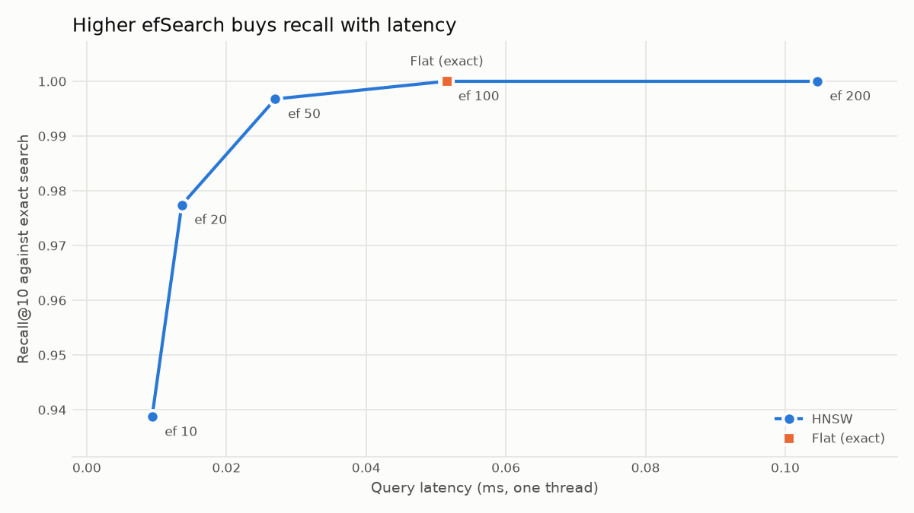

# fine-print

Ask plain-English questions about the Terms of Service and privacy policies of popular apps, and get answers drawn only from the policy text, with a citation for each claim. It runs entirely on your own machine, with no API keys and no cost.

It's built from the individual parts, without LangChain or LlamaIndex, so every step is visible: parsing, chunking, embedding, vector search and prompting. It also measures itself, including where it falls short.

The corpus is 20 documents from 10 companies: Coursera, Discord, Lyft, Netflix, PayPal, Pinterest, Reddit, Spotify, Strava and Zoom. Answers can be wrong and aren't legal advice, so check the cited text.

## Quickstart

You need [uv](https://docs.astral.sh/uv/getting-started/installation/), `make` and [Ollama](https://ollama.com/). uv installs the right Python version for you.

```bash
ollama pull gemma4:e4b   # the local model, a 6.6 GB download that needs 6-7 GB of memory
make setup               # create .venv from uv.lock
make data                # download the policy documents into data/raw/
make index               # build the vector index; the first run downloads the embedding model
```

Then ask from the command line:

```bash
uv run fine-print ask "Can I get a refund?" --company spotify
uv run fine-print ask "Can I get a refund?" --company spotify --retrieve-only   # skips the model
```

Or use the web UI, which talks to the API, so it needs both running in separate terminals:

```bash
make api   # http://127.0.0.1:8000, with interactive docs at /docs
make app   # http://localhost:8501
```

## Commands

| Command | What it does |
| --- | --- |
| `make setup` | Create or repair `.venv` from `uv.lock` |
| `make data` | Download the policy documents |
| `make index` | Build the vector index for both chunking strategies |
| `make eval` | Measure retrieval quality and the refusal threshold on the tuning set |
| `make eval-holdout` | Report on the held-out set, including the model. Never tune from this |
| `make compare` | Compare chunking strategies at matched chunk length, on the tuning set |
| `make bench` | Compare vector index types, and save `docs/benchmark.png` |
| `make api` | Start the API on `127.0.0.1:8000` |
| `make app` | Start the web UI on `localhost:8501` |
| `make lint` | Check linting and formatting |
| `make format` | Apply lint fixes and formatting |
| `make typecheck` | Run the type checker |
| `make test` | Run the tests with coverage; they need no model, index or Ollama |

`uv run fine-print eval --answers` also asks the model every evaluation question. Every setting can be overridden with a `FINE_PRINT_*` environment variable or a `.env` file; see [.env.example](.env.example).

## Environment

`.venv` is managed by uv, so use `uv run` or `.venv/bin/...` to run things. Add dependencies with `uv add` or `uv add --dev`, not `pip`. To start again from scratch, run `rm -rf .venv && make setup`.

## How it works

1. **Ingest** normalizes each policy to Markdown with `#` headings.
2. **Chunk** cuts it into passages of up to 1,000 characters, in one of two ways. `fixed` slides a window over the whole document. `section` never crosses a heading.
3. **Embed** turns each passage into a vector with `BAAI/bge-small-en-v1.5`.
4. **Store** keeps the vectors in a Chroma HNSW index on disk.
5. **Retrieve** finds the closest passages to a question, optionally filtered by company and document type.
6. **Refuse or answer.** If no passage scores at least 0.6, the answer is "Not found in the documents" and the model isn't called. Otherwise `llama3.2` answers from those passages only, and must cite each claim.
7. **Check citations.** Only labels of passages the model was actually shown count as citations. An answer with none is flagged as unverified.

Passages are third-party text, so the prompt tells the model to ignore any instructions inside them.

## Results

> **Read this first.** There are two question sets, reported separately:
>
> - **Tuning set** (31 answerable, 15 unanswerable): the 0.6 refusal threshold was tuned on these questions **only**, so its scores here are optimistic.
> - **Held-out set** (20 answerable, 10 unanswerable, in `eval/holdout/`): written after every setting was fixed, scored once on that frozen configuration, and never tuned on. It covers only the default strategy, so it can't sway a choice between strategies.
>
> Both are small and were written for this project by the same author, so one answerable question moves a score by 3–5 points. A passage counts as relevant if it comes from the right document and contains an expected phrase. That test favours longer chunks and can't tell whether a passage truly answers the question. Measured on an Apple M1 Pro.

### Retrieval

| Question set | Strategy | Chunks | Mean chars | Recall@1 | Recall@3 | Recall@5 | Recall@10 | MRR |
| --- | --- | --- | --- | --- | --- | --- | --- | --- |
| Tuning | section | 1581 | 792 | 0.58 | 0.65 | 0.65 | 0.68 | 0.618 |
| Held-out | section | 1581 | 792 | 0.60 | 0.75 | 0.85 | 0.90 | 0.692 |

Held-out retrieval scores higher than tuning. That isn't evidence the system improved, since no setting was tuned for retrieval and the two sets ask about different facts. It shows how much these scores vary with the questions chosen.

### Refusals and answers

| Measure | Tuning | Held-out |
| --- | --- | --- |
| Answerable questions that pass the 0.6 threshold | 100% | 100% |
| Unanswerable questions the threshold refuses | 53% | 50% |
| Unanswerable questions refused once the model also has a say | 100% | 100% |
| Answerable questions the model answers | 81% | 70% |
| ...with a valid citation | 68% | 55% |
| ...citing a passage that contains the expected text | 48% | 45% |

The threshold, the one setting tuned on these questions, holds up on the held-out set. It catches off-topic questions, but not ones that name a company, such as "How many vacation days do Zoom employees get?". Those score as high as real questions, so the model has to decline them, and on both sets it did.

The weak number is the last one, which stays below 50% on both sets. Retrieval is part of it on the tuning set, where `section` has the expected passage in its top 5 only 65% of the time. But the held-out set finds it 85% of the time and still scores 45%, so the larger limit there is the model: `llama3.2` wrongly refused 6 of 31 tuning questions and 6 of 20 held-out ones, and it can answer from the wrong sentence of a passage. A citation also only shows that the model named a passage, not that the passage supports the claim.

### Chunking comparison (`make compare`, tuning set only)

The keyword test favours longer chunks, and at the default size limit fixed chunks are about 25% longer than section chunks. So this also scores fixed chunks with their size limit set to match the section mean, keeping the same 150-character overlap.

| Run | Size limit | Chunks | Mean chars | Recall@1 | Recall@3 | Recall@5 | Recall@10 | MRR |
| --- | --- | --- | --- | --- | --- | --- | --- | --- |
| section | 1000 | 1581 | 792 | 0.58 | 0.65 | 0.65 | 0.68 | 0.618 |
| fixed, default size | 1000 | 1367 | 989 | 0.52 | 0.71 | 0.74 | 0.81 | 0.614 |
| fixed, matched length | 802 | 1789 | 792 | 0.42 | 0.61 | 0.61 | 0.71 | 0.518 |

`fixed` leads at the top 5 only at its longer default size. At matched length it falls behind `section` everywhere except Recall@10, so most of that lead appears to come from chunk length. `section` remains the default, and the choice is still open. The difference between the matched runs at the top 5 is about one question, so this leans towards `section` without proving it.

### Vector index (`make bench`)

Run on the 1,581 `section` vectors, using the 31 tuning questions as queries, on one thread.

| Index | efSearch | Recall@10 vs flat | Query latency (ms) | Build time (ms) |
| --- | --- | --- | --- | --- |
| Flat | - | 1.000 | 0.0515 | 3.27 |
| HNSW | 10 | 0.939 | 0.0093 | 144.96 |
| HNSW | 20 | 0.977 | 0.0136 | 144.96 |
| HNSW | 50 | 0.997 | 0.0270 | 144.96 |
| HNSW | 100 | 1.000 | 0.0514 | 144.96 |
| HNSW | 200 | 1.000 | 0.1045 | 144.96 |



## Design decisions

### Keeping HNSW at `efSearch` 100

At about 1,600 vectors, HNSW gives no speed advantage over exact search. At `efSearch` 100 both take about 0.05 ms per query and both reach full recall, and exact search builds far faster. We keep HNSW at 100 anyway: Chroma's index is HNSW, full recall is the safe setting, and the search time is tiny next to the model's seconds. Lowering `efSearch` to 50 would be twice as fast, but saving 0.02 ms isn't worth any lost recall here.

HNSW starts to matter as the corpus grows, because exact search slows in proportion to the number of vectors while HNSW barely slows:

| Vectors | Flat (ms) | HNSW, `efSearch` 100 (ms) | HNSW recall@10 | HNSW build (s) |
| --- | --- | --- | --- | --- |
| 1,581 (real) | 0.051 | 0.056 | 0.999 | 0.1 |
| 10,000 | 0.343 | 0.100 | 1.000 | 0.3 |
| 100,000 | 3.296 | 0.149 | 1.000 | 5.2 |
| 500,000 | 16.320 | 0.141 | 0.998 | 23.9 |

Only the first row is the real corpus. The larger ones are synthetic, made by resampling our vectors with a little noise, with 200 more made the same way as queries, on one search thread. That data is clustered around real vectors and may be easier than a genuinely larger corpus, so read them as the trend and not as a promise. HNSW overtakes exact search by about 10,000 vectors, roughly 6 times this corpus, or around 60 companies at the current size. Even at 500,000 vectors exact search takes just 16 ms, so for one local user the speed only clearly matters at millions of vectors, or under many simultaneous queries.

## Limitations

- **Small, local model.** `llama3.2` sometimes refuses when the answer is in front of it, and once repeated itself until the 512-token reply cap cut it off.
- **Keyword relevance.** The evaluation can't see whether a passage really answers a question.
- **Unverified citations.** Nothing checks that a cited passage supports the claim.
- **Replaced services.** The source archives have no usable documents for Uber and Duolingo, and no real privacy policy for Airbnb, so Lyft, Coursera and PayPal are in the corpus instead.
- **Older Strava text.** Strava comes from a 2024-07-15 snapshot, while the others are current to the download.
- **Page furniture.** Strava's documents and Zoom's terms begin with site navigation text, which ingestion doesn't remove from Markdown files.
- **Repeated text.** Reddit's terms contain two regional versions of the agreement, so results can show near-identical passages.

## Privacy

Everything runs locally. Chroma's telemetry is off, `make app` turns off Streamlit's, and both services listen only on localhost. The embedding model is downloaded from Hugging Face on first use; once it's cached, it loads without contacting them.

## Stack

Python 3.14, uv, BeautifulSoup, pypdf, sentence-transformers, Chroma, FAISS (benchmark only), Ollama, FastAPI, Streamlit, Typer, structlog, pytest, Ruff and ty.
