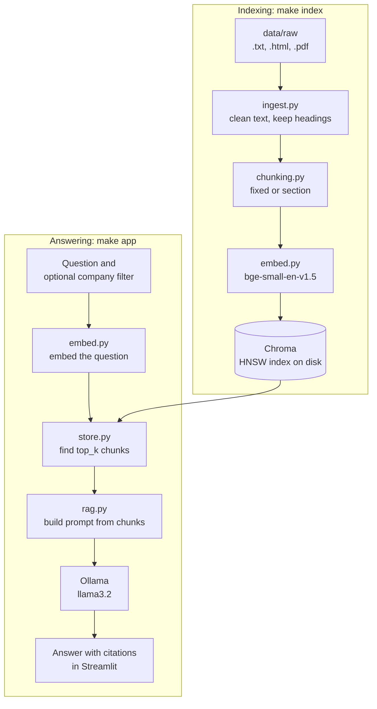

# fine-print

Nobody reads the Terms of Service, but everybody agrees to them. **fine-print** lets you ask plain-English questions, such as "Can I get a refund?" or "Do they sell my data?", and get answers drawn only from the policy text, with a citation for each claim. It's a retrieval-augmented generation (RAG) system built from the individual parts, without LangChain or LlamaIndex, so every step is visible: parsing, chunking, embedding, vector search and prompting. It runs entirely on your own machine, with no API keys and no cost. It also measures its own retrieval quality, because a RAG demo that seems to work and one you can show works are different things.

> **Status:** the repo ships with two fictional sample documents, so the pipeline runs out of the box. The results below test the plumbing and say little about retrieval quality on real policies. See [Results](#results).

## Architecture



## Quickstart

You need [uv](https://docs.astral.sh/uv/) and [Ollama](https://ollama.com/).

```bash
ollama pull llama3.2     # the local LLM, about 2 GB
make install             # creates .venv and installs the Python packages
make index               # builds both indexes; the first run downloads the embedding model
make app                 # opens the UI at http://localhost:8501
```

| Command | What it does |
| --- | --- |
| `make install` | Create `.venv` with Python 3.11 and install dependencies |
| `make index` | Build the Chroma index for both chunking strategies |
| `make eval` | Report recall@k and MRR for each strategy |
| `make bench` | Compare FAISS flat and HNSW search |
| `make app` | Start the Streamlit UI |
| `make test` | Run the tests (no Ollama or index needed) |

You can also work from the command line:

```bash
uv run python scripts/ask.py "Can I cancel for free?" --company ridely
uv run python scripts/ask.py "Can I cancel for free?" --retrieve-only   # skips the LLM
```

To use a different LLM, run `FINE_PRINT_OLLAMA_MODEL=mistral make app`. All other settings are in [config.py](src/fine_print/config.py).

### Using real documents

1. Add files to `data/raw/` named `<company>_<doctype>.<ext>`, such as `spotify_privacy.txt` or `uber_terms.html`. The text before the first underscore becomes the company name.
2. Delete `tunely_privacy.txt` and `ridely_terms.html` from `data/raw/`. If the folder is ever empty, the samples are copied back and a notice is printed.
3. Replace `eval/questions.jsonl` with questions about your documents.
4. Run `make index`, then `make eval` and `make bench`.

Each evaluation question names a company and the keywords that a relevant chunk must contain:

```json
{"question": "Can I bring my dog in a Ridely car?", "company": "ridely", "keywords": ["pet option"]}
```

## Project layout

```
src/fine_print/
  config.py     every setting, in one place
  ingest.py     load and clean documents, keep section headings
  chunking.py   the fixed_size and section_aware strategies
  embed.py      embedding wrapper with batching
  store.py      build and query Chroma, with metadata filters
  rag.py        retrieve, build the prompt, call Ollama, extract citations
  evaluate.py   recall@k and MRR for each strategy
scripts/        build_index.py, ask.py, benchmark_index.py
app.py          Streamlit UI
eval/           questions.jsonl
tests/          pytest suite
```

## The concepts, in plain language

### Chunking

Whole policies are too long to embed well or to fit in a prompt, so we cut them into passages. The cut matters: an answer split across two chunks may never be found, and a chunk that covers five topics matches none of them strongly. This project compares two strategies:

- **Fixed size** slides a 150-word window through the document, with each window sharing 30 words with the previous one. The overlap means a sentence cut at one boundary still appears whole in the neighbouring chunk. It's simple, but it ignores the document's structure.
- **Section-aware** makes one chunk per section, and splits a section only if it's longer than 150 words. Chunks stay on one topic and each begins with its heading, but their sizes vary.

### Embeddings

An embedding model turns text into a list of numbers (here, 384 of them), placing passages with similar meanings close together. That's why "get my money back" can match a passage about "refunds" even though they share no words. We use `BAAI/bge-small-en-v1.5`, which is small enough to run quickly on a laptop.

### Cosine similarity

To compare two embeddings, we measure the angle between them. The score is 1 if they point the same way and near 0 if they're unrelated. We normalize every vector to length 1, which makes cosine similarity the same as a simple dot product. Chroma reports *distance*, which is `1 - similarity`.

### HNSW, and what M and ef do

Comparing a question with every vector is exact, but gets slow at large scale. HNSW (Hierarchical Navigable Small World) instead links each vector to its near neighbours, forming a graph with several levels. It's a bit like travelling by motorway, then main roads, then side streets: a search jumps across the upper levels and then closes in on the target. It's very fast, but it's *approximate*, so it can occasionally miss a true nearest neighbour.

| Setting | Meaning | Raising it |
| --- | --- | --- |
| `M` | Links per node in the graph | Better recall, more memory |
| `construction_ef` | Candidates considered when adding a node | A better graph, slower build; no effect on query speed |
| `search_ef` | Candidates considered when answering a query | Better recall, slower queries |

### Metadata filtering

Every chunk is stored with its `company`, `doc_type`, `section`, `chunk_id` and `strategy`. Choosing a company adds a filter, so results can only come from that company's documents. Without it, a question about Uber's refunds might retrieve another company's refund section, because the two passages mean almost the same thing.

### RAG

An LLM on its own will confidently answer from memory, which may be outdated or invented. Retrieval-augmented generation instead has three steps: **retrieve** the most relevant chunks, **augment** the prompt with them, and **generate** an answer. Here the prompt tells the model to use only that text, cite each claim as `[company - section]`, and reply "Not found in the documents" if the text doesn't contain the answer. The app checks each citation against the retrieved chunks, and warns you if the answer has no valid citation.

### Recall@k and MRR

These measure retrieval only, so they don't involve the LLM. For each test question, we find the position of the first relevant chunk, meaning one from the right company that contains all the expected keywords.

- **Recall@k** is the share of questions with a relevant chunk in the top k. If this is low, the LLM never sees the answer, and no prompt can make up for that. With one target per question, this is sometimes called *hit rate*.
- **MRR** (mean reciprocal rank) rewards ranking the relevant chunk highly. A first place scores 1, a second place scores 1/2, a third place scores 1/3, and a miss scores 0.

## Results

> **Read this first.** These are real outputs, but they come from **two small fictional documents and 10 questions written by the author of those documents**. They show that the pipeline and its measurements work. They don't show how well either strategy or index works on real policies. To get meaningful numbers, follow [Using real documents](#using-real-documents) and rerun both commands.

Measured on an Apple M1 Pro with Python 3.11.

### Chunking evaluation (`make eval`)

| Strategy | Chunks | Recall@1 | Recall@3 | Recall@5 | Recall@10 | MRR |
| --- | --- | --- | --- | --- | --- | --- |
| fixed | 10 | 0.90 | 0.90 | 1.00 | 1.00 | 0.925 |
| section | 23 | 0.70 | 0.90 | 1.00 | 1.00 | 0.803 |

**This doesn't show that fixed-size chunking is better.** Fixed chunks average 147 words and section chunks average 57, and the larger a chunk is, the more likely it is to contain a keyword. The keyword test also can't see that a large chunk gives the LLM more irrelevant text. Recall@10 is of little use here too, because the fixed index holds only 10 chunks, so its top 10 is everything. A fairer comparison would use a larger corpus with similar chunk sizes.

### FAISS benchmark (`make bench`)

Run on the 23 section-aware chunks, using the 10 evaluation questions as queries.

| Index | efSearch | Recall@10 vs flat | Query latency (ms) | Build time (ms) |
| --- | --- | --- | --- | --- |
| Flat | - | 1.000 | 0.0027 | 0.65 |
| HNSW | 10 | 1.000 | 0.0037 | 0.88 |
| HNSW | 20 | 1.000 | 0.0038 | 0.88 |
| HNSW | 50 | 1.000 | 0.0040 | 0.88 |
| HNSW | 100 | 1.000 | 0.0041 | 0.88 |
| HNSW | 200 | 1.000 | 0.0041 | 0.88 |

**At this size, HNSW has no chance to show its value.** Every setting reaches perfect recall because 23 vectors is too few for an approximate search to miss anything, and exact search is faster because it has almost no work to do. The trade-off HNSW exists for usually appears at many thousands of vectors or more. Latency differences this small are also close to measurement noise.

### A known failure

Asking "Will Tunely sell my data?" returns "Not found in the documents", even though the policy says "We never sell your personal information". Two separate things go wrong:

1. **Retrieval is weak here.** The correct chunk ranks only 5th, behind generic chunks such as the document's introduction and contact details. For the wording "Does Tunely sell data?", it drops out of the top 5.
2. **The model abstains anyway.** Even with that chunk in its context, `llama3.2` still says the answer isn't there.

The evaluation counts the similar test question as a success at k=5, because recall@k can't see the second problem. So a good retrieval score doesn't guarantee a good answer.

## Limitations and next steps

**Limitations**

- The heading detection for `.txt` and `.pdf` files relies on simple patterns: Markdown, numbered, ALL CAPS and standalone Title Case lines. A sentence-case heading is treated as body text, and a PDF's page headers and footers aren't removed.
- Scanned PDFs have no text to extract, so they're skipped with a warning.
- Keyword matching is only a stand-in for true relevance, and it favours longer chunks.
- Citations are checked against the retrieved chunks, but nothing verifies that a cited passage really supports the claim.
- A small local model can abstain wrongly, as shown above, and can also make mistakes. Answers aren't legal advice.

**Next steps**

- **Hybrid search:** combine vector search with keyword search (BM25). Legal text relies on exact terms such as "arbitration", which keyword search finds reliably.
- **Reranking:** retrieve 20 or more candidates, then have a cross-encoder model reorder them. This targets the failure above, where generic chunks outrank the correct one.
- **LLM judge:** have a second model grade each answer for faithfulness and completeness, so that answer quality is measured as well as retrieval.

## Stack

Python 3.11, uv, BeautifulSoup, pypdf, sentence-transformers, Chroma, FAISS (benchmark only), Ollama, Streamlit and pytest. Chroma's telemetry is turned off, and `make app` also turns off Streamlit's telemetry and listens only on localhost. Your documents and questions stay on your machine. The Hugging Face library does contact its servers to check for model updates when it loads the embedding model. Once the model is downloaded, set `HF_HUB_OFFLINE=1` to stop that.
